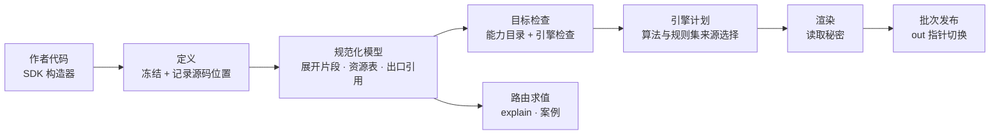

# 架构

proxylang 是一个库加一个命令行入口。作者在 `proxylang.config.ts` 中用 SDK 构造 [Profile](concepts.md#profile)，CLI 加载这个文件，检查全部 Profile，执行[路由案例](concepts.md#route-case)，再为每份 Profile 生成一个原生配置文件。

## 数据流

1. **定义**：每个构造器校验自己的输入，复制作者传入的普通容器与字段，冻结结果，并在内部登记“这是 SDK 创建的对象”以及它在作者代码中的定义位置。传入的 SDK 对象（节点、分组、隧道、规则集、秘密引用）按引用保留，不复制，因此对象身份在整个流程中保持不变。`defineProfile` 与 `defineBuild` 同样只复制容器、不复制 SDK 对象。见[对象身份](#对象身份)。
2. **规范化模型**：展开嵌套片段，按对象身份登记资源并保留列表顺序，建立分组成员与 `via` 组成的依赖图，给每条路由编号并保留定义位置。模型同时保留目标求值与编码需要的全部声明：协议选项、TCP-only 与 UDP 能力、隧道与 endpoint 的类型和状态目录、DNS 规则、TUN、`serverAliases`、嗅探与解析选项。这一步检查登记、重复 id 与依赖环。
3. **目标检查**：按 Profile 的[目标](concepts.md#target)查能力目录，检查协议及其选项、分组算法与成员类型、条件、规则集来源、DNS、隧道、TCP-only 在所有可选路径上的传播，再执行该引擎专属的检查。
4. **引擎计划**：为每个 `group.auto()` 选择目标上的具体算法，为每个[规则集](concepts.md#rule-set)选择该引擎的来源并按引擎规则去重，确定原生名字映射，以及需要插入的辅助原生规则（嗅探、DNS 劫持、解析）和原生规则序号到作者路由序号的映射。选择记录写进 check 结果。
5. **路由求值**：在规范化模型上按顺序求值条件，得到首条命中的路由和出口。求值读取模型中记录的目标语义参数（嗅探方式、哪些条件会触发解析），不依赖渲染结果。`explain` 与路由案例共用这一步。
6. **渲染**：引擎渲染器把引擎计划编码成原生文本。只有渲染阶段按构建定义的秘密集合读取秘密值，同一批次内每个秘密只读取一次。
7. **批次发布**：全部 Profile 渲染成功后写入新的一批文件，最后切换 `out` 指针。

1 至 5 步是纯函数：不读文件、不读环境变量、不读秘密。`check` 与 `explain` 只执行这几步。

## 模块

| 模块 | 职责 | 依赖 |
| --- | --- | --- |
| `src/authoring/` | 公开构造器与 `defineProfile`、`defineBuild`；输入校验与定义快照 | `model/` 的类型 |
| `src/model/` | 规范化模型的类型与规范化过程；诊断结构 | 无 |
| `src/targets/` | 唯一的能力目录与通用的目标检查 | `model/` |
| `src/engines/surge/` | Surge 专属检查、引擎计划与 `.conf` 渲染 | `model/`、`targets/` |
| `src/engines/sing-box/` | sing-box 专属检查、引擎计划与 `.json` 渲染，包括 DNS、TUN、endpoint 与 fragment 模式 | `model/`、`targets/` |
| `src/engines/mihomo/` | Mihomo 专属检查、引擎计划与 `.yaml` 渲染 | `model/`、`targets/` |
| `src/engines/stash/` | Stash 专属检查与 `.yaml` 渲染 | `model/`、`targets/` |
| `src/routing/` | 条件求值、`explain` 与路由案例 | `model/` |
| `src/build/` | `checkBuild`、`runBuild`、秘密读取与批次发布 | 以上全部 |
| `src/cli.ts` | 加载可信配置文件，解析参数，输出结果与退出码 | `build/` |
| `src/index.ts` | 公开导出清单，只重新导出 `authoring/`、`build/` 与 `routing/` 的公开名字 | — |

依赖关系以表格“依赖”列为准：`engines/` 之间互不引用，`routing/` 不依赖任何引擎模块（目标语义参数由模型提供），`model/` 不依赖其它模块。引擎渲染器之间没有共享的中间配置格式；共享的只有规范化模型与能力目录。Mihomo 与 Stash 的 YAML 写法相近，可以共享一个只负责序列化的模块，但各自的检查和编码规则分开。

## 不变量

- 规范化模型在一份 Profile 内只建立一次，多个检查和求值都读取同一份冻结数据，不互相修改。
- 秘密值不进入任何 SDK 对象或模型；模型里只有不带值的秘密引用。
- 每条诊断都有稳定的 `code`、Profile id 和模型路径；能取得定义位置时带上 `origin`。取不到定义位置不影响检查结果。
- 诊断、check 输出和错误信息里不出现秘密值，也不出现节点密码、UUID、密钥等凭据字段的值。
- 引擎计划只选择作者声明过的实现；没有对应实现时报错，不改用另一个分支。
- 同样的输入得到字节相同的产物。

## 失败阶段

| 阶段 | 例子 | 结果 |
| --- | --- | --- |
| 加载与定义 | 配置文件不存在；import 抛出异常；构造器或 `defineProfile` 因结构错误抛出 `ProfileDefinitionError` | CLI 以 `CONFIG_LOAD_FAILED` 失败，不检查任何 Profile。结构错误给出 `code`、`paths` 与抛出位置 |
| 规范化与目标检查 | 未登记的出口、不支持的协议、缺少引擎实现 | 报告全部 Profile 的全部诊断，批次失败 |
| 路由案例 | 首条命中的出口与期望不符 | 报告全部案例结果，批次失败 |
| 渲染 | 秘密读取失败 | 不写入任何新文件，旧产物保持不变 |
| 发布 | 指针切换失败 | 报告恢复所需的信息，见[构建与发布](feature/build/architecture.md) |

## 对象身份

- 构造器对传入的 SDK 对象只保存引用。作者直接写的对象字面量（例如 `surge.general` 的片段）被复制并冻结。
- 资源字段只接受 SDK 构造器创建的对象；形状相同、但不是由构造器创建的对象，在定义阶段报 `INVALID_RESOURCE`。
- 同一个 SDK 对象可以被多份 Profile 共用。登记与重复检查在每份 Profile 内独立进行，没有全局所有权。
- 同一个对象在一份 Profile 的 `proxies` 或 `groups` 中出现多次时，只保留第一次出现的位置。两个不同对象使用同一个 id 时报 `DUPLICATE_ID`。
- 定义位置存放在以对象为键的内部表中。没有构造器的对象字面量使用所在 `defineProfile` 调用的位置；取不到时省略。

## 契约归属

- [编写 Profile](feature/profile/README.md)：构造器、出口引用、片段组合和引擎专属字段。
- [目标与原生输出](feature/targets/README.md)：能力目录、各引擎的编码规则与不支持项。
- [路由案例](feature/routing-cases/README.md)：请求模型、求值语义、`explain` 与 `cases`。
- [构建与发布](feature/build/README.md)：构建定义、秘密、CLI 与产物生命周期。
- [测试架构](engineering/testing/README.md)：各层测试分别证明什么。
